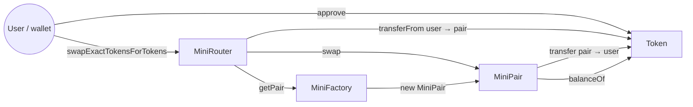

# 01 · Architecture

← [Index](README.md) · [02 Swap lifecycle](02-swap-lifecycle.md) →

## The four contracts

| Contract | File | Holds funds | Job |
| --- | --- | --- | --- |
| `Token` | `src/Token.sol` | balances of its own token | minimal ERC-20; `mint` is open to anyone (practice only) |
| `MiniFactory` | `src/MiniFactory.sol` | no | creates one `MiniPair` per token pair and remembers its address |
| `MiniPair` | `src/MiniPair.sol` | **yes** — both tokens of the pool | records reserves and LP shares, runs `mint`, `burn`, `swap` |
| `MiniRouter` | `src/MiniRouter.sol` | no | quotes, moves the user's tokens into the pair, calls the pair, adds `deadline` / `amountOutMin` checks |

The pair is the only contract that matters for correctness. It trusts nobody: it does not know
who sent tokens or why, it only compares its token balances with its recorded reserves. The
router is a convenience that a wallet calls; any contract or EOA can call the pair directly
(`test_05`).

## Who calls whom

Token movements in one swap never touch the router: `transferFrom` moves the input from the user
**straight to the pair**, and the pair sends the output **straight to the receiver**
(`src/MiniRouter.sol:82`, `src/MiniPair.sol:105-106`). `test_01` asserts the router's balances stay
zero.

## State

### `MiniPair`

| Variable | Type | Meaning |
| --- | --- | --- |
| `token0`, `token1` | `address immutable` | the two tokens, sorted by address in the constructor (`src/MiniPair.sol:50`) |
| `reserve0`, `reserve1` | `uint256` | balances recorded at the end of the last `mint` / `burn` / `swap` |
| `totalShares` | `uint256` | sum of all LP shares |
| `sharesOf` | `mapping(address => uint256)` | LP shares per account |
| `locked` | `bool` (private) | re-entrancy guard used by the `lock` modifier |

Reserves are a **copy** of the balances. The difference between balance and reserve is what the
pair treats as "tokens that just arrived" — that is how `mint` and `swap` learn the input amount.

### `MiniFactory`

| Variable | Meaning |
| --- | --- |
| `getPair[tokenA][tokenB]` | pair address, stored in both directions |
| `allPairs` | every pair created, in order |

### `MiniRouter`

Only `factory` (immutable). The router has no storage of its own.

## Token ordering

A pair always stores the smaller address as `token0`. The caller of `pair.swap` must say the output
in the right slot: `swap(amount0Out, amount1Out, …)`. The router works this out with
`input == pair.token0()` (`src/MiniRouter.sol:95-96`); the tests use `_wethOut`
(`test/Swap.t.sol:344`) for the same reason. In the local playground USDC happens to be
`token0`; in the tests the order depends on the deployed addresses, which is why the code never
assumes it.

## Why the pair "sends first, checks after"

The pair does not take tokens from anyone — it has no allowance. The input must already be in the
pair when the final check runs. This gives two ways to pay:

1. **Pay before calling** (`transfer` or `transferFrom` into the pair, then `swap`). The router does
   this in one transaction.
2. **Pay during the callback** (flash swap). The pair sends the output, calls `miniCall` on the
   receiver, and the receiver pays back before `miniCall` returns.

In both cases the check at the end (`src/MiniPair.sol:112-121`) is the same. See
[02 Swap lifecycle](02-swap-lifecycle.md) and [05 Multi-hop and flash swaps](05-multihop-and-flash-swaps.md).

---

← [Index](README.md) · [02 Swap lifecycle](02-swap-lifecycle.md) →
