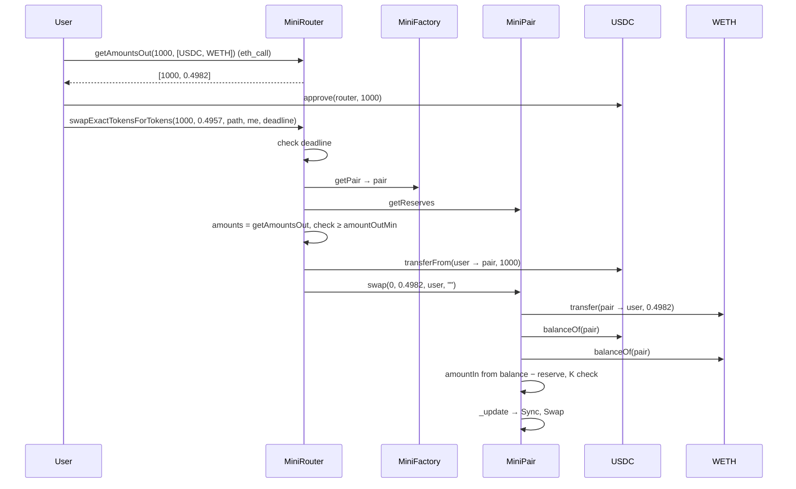

# 02 · Swap lifecycle

← [01 Architecture](01-architecture.md) · [Index](README.md) · [03 Math](03-math.md) →

This page follows one swap — **1,000 USDC → WETH** in the pool of 1,000 WETH + 2,000,000 USDC —
from the quote to the last event. The numbers are the logs of `test_01_SwapStepByStep`.



## Step 0 — quote (off-chain)

The wallet calls `router.getAmountsOut(1000e18, [USDC, WETH])` with `eth_call`. Nothing is sent and
nothing costs gas. The router reads the reserves and applies the formula
(`src/MiniRouter.sol:28-44`):

```
amountOut = 1000 × 997 × 1000 / (2,000,000 × 1000 + 1000 × 997) = 0.4982 WETH
```

The wallet then sets `amountOutMin` from the quote. With 0.5% slippage:
`0.4982 × 0.995 = 0.4957 WETH`. It also sets `deadline`, usually now + 20 minutes.

The quote is only valid for the reserves **at that moment**. Any swap that lands first changes
them (`test_04`).

## Step 1 — `approve`

The router will pull USDC with `transferFrom`, so the user first calls
`USDC.approve(router, 1000e18)`. Without it, the swap reverts with `Token: allowance`
(`test_02`). An unlimited approve (`type(uint256).max`) skips this step next time but leaves the
router able to pull everything later; `Token.transferFrom` does not decrease an unlimited
allowance (`src/Token.sol`).

## Step 2 — the router

`swapExactTokensForTokens(1000e18, 0.4957e18, [USDC, WETH], user, deadline)`
(`src/MiniRouter.sol:72-84`):

| Order | Code | What happens | Revert |
| ---: | --- | --- | --- |
| 1 | `ensure(deadline)` | `deadline >= block.timestamp` | `MiniRouter: EXPIRED` |
| 2 | `getAmountsOut` | recompute the output **from the current reserves** | — |
| 3 | `require(... >= amountOutMin)` | slippage limit | `MiniRouter: INSUFFICIENT_OUTPUT_AMOUNT` |
| 4 | `_transferFrom(path[0], user, pair, amountIn)` | 1,000 USDC go from the user to the pair | `Token: allowance` / `Token: balance` |
| 5 | `_swap` | for each hop, call `pair.swap` with the output in the right slot | errors from the pair |

The router never calls `transfer` for the output and never holds tokens.

## Step 3 — the pair

`pair.swap(0, 0.4982e18, user, "")` (`src/MiniPair.sol:99-125`). Here USDC is token0, so the
output (WETH) is `amount1Out`.

| Order | Lines | What happens |
| ---: | --- | --- |
| 1 | 100-102 | sanity checks: some output, less than the reserve, `to` is not one of the tokens |
| 2 | 105-106 | **send the output first**: 0.4982 WETH → user |
| 3 | 109 | `data` is empty → no callback |
| 4 | 112-113 | read real balances: USDC 2,001,000; WETH 999.5017 |
| 5 | 114-116 | input = balance − (reserve − output): USDC in = 1,000; WETH in = 0 |
| 6 | 119-121 | `K` check with the 0.3% fee taken from the input side |
| 7 | 123 | `_update`: reserves = balances, emit `Sync` |
| 8 | 124 | emit `Swap(sender = router, 1000, 0, 0, 0.4982, user)` |

If any check fails, the whole transaction reverts, including the transfer in step 2.

## Step 4 — the result

| | Before | After |
| --- | ---: | ---: |
| Reserve WETH | 1,000.0000 | 999.5017 |
| Reserve USDC | 2,000,000.0000 | 2,001,000.0000 |
| Spot price | 2,000.0000 | 2,001.9974 |
| User USDC | 10,000 | 9,000 |
| User WETH | 0 | 0.4982 |

Effective price: `1000 / 0.4982 = 2,007.02` USDC per WETH — 0.35% above the spot price
(0.3% fee + price impact). `k` grows because the fee stays in the pool.

The receipt has four logs, in this order:

| Log | Emitter | Meaning |
| --- | --- | --- |
| `Transfer(user → pair, 1000)` | USDC | step 2.4 |
| `Transfer(pair → user, 0.4982)` | WETH | step 3.2 |
| `Sync(2001000, 999.5017)` | pair | new reserves |
| `Swap(router, 1000, 0, 0, 0.4982, user)` | pair | the swap summary indexers read |

## What changes when the price moves first

`test_04`: Bob swaps 50,000 USDC → WETH before Alice. Alice's quote was 0.4982 WETH, but at
execution the router computes 0.4742 WETH, below her `amountOutMin` of 0.4957. Step 2.3 reverts,
Alice keeps her USDC and loses only gas. With `amountOutMin = 0` she would have received 0.4742.

---

← [01 Architecture](01-architecture.md) · [Index](README.md) · [03 Math](03-math.md) →
