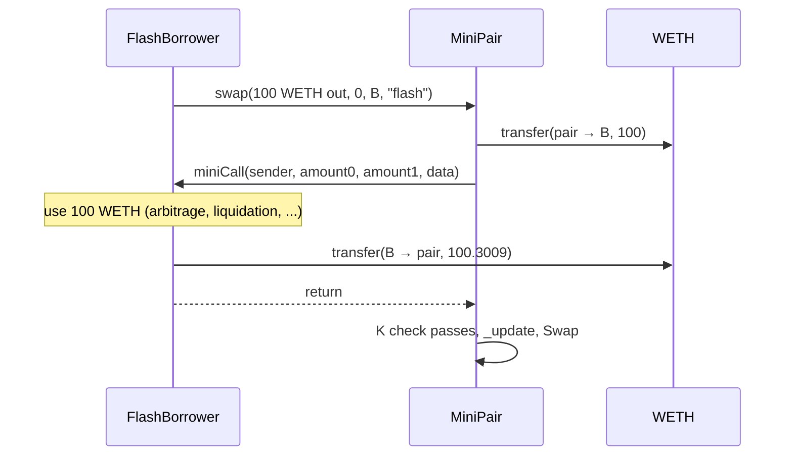

# 05 · Multi-hop and flash swaps

← [04 Liquidity](04-liquidity.md) · [Index](README.md) · [06 Security](06-security.md) →

## Multi-hop

When there is no pair for the two tokens you want, the router goes through a common token.
`path = [USDC, WETH, PEPE]` means: USDC → WETH in the WETH/USDC pair, then WETH → PEPE in the
PEPE/WETH pair.

### Quote

`getAmountsOut` (`src/MiniRouter.sol:36-44`) runs `getAmountOut` hop by hop; the output of one hop
is the input of the next. Each hop pays its own 0.3% fee and its own price impact.

### Execution

`_swap` (`src/MiniRouter.sol:88-101`):

| Hop | Pair | Output goes to |
| ---: | --- | --- |
| 1 | WETH/USDC | **the PEPE/WETH pair** (`to = _pair(output, path[i + 2])`) |
| 2 | PEPE/WETH | the user (`_to`) |

The router only pushes the first input (`transferFrom` user → pair 1). After that, every pair pays
the next pair directly, and the next pair finds the tokens as "balance − reserve" when its own
`swap` runs. Nobody in the middle — not the user, not the router — ever holds the WETH.

`test_10_MultiHop` (Alice, 1,000 USDC):

| Hop | In | Out |
| ---: | ---: | ---: |
| 1 | 1,000.0000 USDC | 0.4982 WETH |
| 2 | 0.4982 WETH | 4,943.0139 PEPE |

Assertions: pair 2's WETH reserve went up by exactly hop 1's output; Alice's and the router's WETH
balances stay 0.

### Choosing a path

The caller passes the path. Aggregators are the services that pick it, searching many pools and
DEXes and often splitting one order across several paths.

## Flash swaps

A flash swap is a `pair.swap` call with non-empty `data`. The pair sends the output first, then
calls `miniCall` on the receiver (`src/MiniPair.sol:109`), and only after `miniCall` returns does it
run the `K` check. The receiver can do anything with the tokens in between, as long as the pair has
enough back when the check runs.



### The receiver

`IMiniCallee` (`src/MiniPair.sol:10-12`):

```solidity
function miniCall(address sender, uint256 amount0, uint256 amount1, bytes calldata data) external;
```

| Parameter | Value |
| --- | --- |
| `sender` | `msg.sender` of `pair.swap` (who started the flash swap) |
| `amount0`, `amount1` | what the pair sent |
| `data` | the bytes passed to `swap`, untouched |

A real receiver must check `msg.sender == pair`; otherwise anyone can call `miniCall` directly.
`FlashBorrower` in `test/Swap.t.sol` does this.

### Ways to pay back

| Pay back in | Cost | Effect |
| --- | --- | --- |
| the same token | `R ≥ B × 1000 / 997` (≈ 0.3009% fee) | a loan — reserves end slightly higher |
| the other token | the normal `getAmountOut` math in reverse | a regular swap where you got the output first |
| a mix | anything that satisfies the `K` check | — |

Math in [03 Math](03-math.md#flash-swap-repayment).

### Tests

| Test | Borrow | Repay | Result |
| --- | ---: | ---: | --- |
| `test_11_FlashSwapPaysBackWithFee` | 100 WETH | 100.3009 WETH | passes; the borrower held 101 WETH during the callback (100 borrowed + 1 of its own) |
| `test_12_FlashSwapWithoutFeeReverts` | 100 WETH | 100 WETH | `MiniPair: K` |

When the check fails, the transfer out is reverted too — the pair never loses the tokens.

---

← [04 Liquidity](04-liquidity.md) · [Index](README.md) · [06 Security](06-security.md) →
